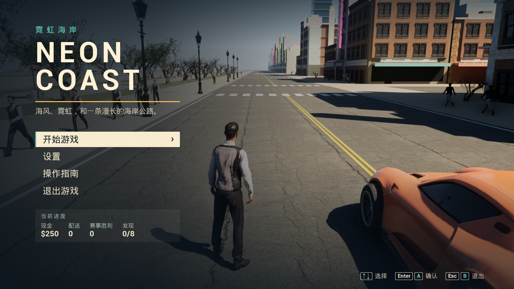

# NEON COAST · 霓虹海岸

基于 Unreal Engine 5.8.4 的原创海滨开放世界游戏原型，Windows 64 位，离线单人。

**[下载 v0.4.0 安装版或便携版](https://github.com/j3488866194-bot/NeonCoast/releases/tag/v0.4.0)** · [操作与设置](docs/UE_FRONTEND.md) · [验证记录](docs/UE_VERIFICATION.md)



## 安装与游玩

下载 Release 中的 `NeonCoast-0.4.0-Windows-Setup.exe`，安装后使用桌面或开始菜单的 **Neon Coast**。也可以解压完整便携 ZIP，运行 `NeonCoast.exe`。无需安装 UE 编辑器、Python 或开发工具。当前发行包使用 Windows 10/11 64 位和 DX12；实测硬件、性能参考和验证边界见验证记录。

首次进入主菜单后选择“开始游戏”。**设置 → 画面**提供窗口、无边框、全屏，以及分辨率、画质、帧率上限和垂直同步。更改显示模式后有 15 秒确认，超时自动恢复。游戏中按 **Esc / 手柄 Menu** 暂停，**F11** 快速切换窗口与无边框。

WASD 移动/驾驶，F 上下车及高速跳车，E 交互，鼠标右键瞄准、左键射击、R 换弹，M 地图。支持键鼠和 Xbox 式手柄。鼠标上移、右摇杆上推默认向上看，步行和驾驶一致；设置可独立调整灵敏度、Y 轴反转和死区。

## 当前内容

- Chaos 四轮车辆物理、交通车辆、高速跳车、车辆损坏和维修。
- 主角与 64 名行人、扫描人物模型、步行/跑步/跳跃动画、惊恐和受击反应。
- 警车追捕、视线追踪和搜索，瞄准射击、换弹、医疗与现金。
- 三阶段原创快递任务、8 门街道赛、8 枚探索代币和进度存档。
- 昼夜、地图、照片模式、原创合成音频、电台和引擎声。
- 主菜单、暂停、操作指南、画面/操控/声音设置、退出保存。
- Poly Haven 建筑立面、海岸树、长椅、路灯与 16 套 PBR 材质。

这是持续开发的原型。当前不具备 GTA VI 的城市规模、动画质量或完整剧情；没有联机、完整室内、船舶和飞机。两种扫描人物外观仍会重复，部分动作仍使用基础动画。项目与 Rockstar Games 无关联，不含其游戏代码、角色、音乐或泄露素材。[官方资讯参考范围](docs/GTA_REFERENCE_NOTES.md)。


菜单和写实视觉由**实际 Claude Opus 5.5 high**参与制作；Codex 负责玩法、资产接入、输入/设置后端、构建与验证。[菜单调用回执](docs/UE_FRONTEND_OPUS_RECEIPTS.json) · [写实视觉回执](docs/UE_REALISM_OPUS_RECEIPTS.json)。

## 开发与重建

工程入口为 `Unreal/NeonCoast.uproject`。需要合法安装 UE 5.8、MSVC x64 编译工具及 .NET Framework SDK。先按[写实资源重建说明](docs/UE_REALISM.md)下载授权素材并完成 Blender/UE 导入；扫描人物原始文件和未 Cook 资产不随 Git 分发。首次基础构建还需 `python tools/generate-audio.py`。

```powershell
# 编译与资源准备
powershell -ExecutionPolicy Bypass -File tools/unreal.ps1 -Action Prepare
# 打包独立游戏
powershell -ExecutionPolicy Bypass -File tools/unreal.ps1 -Action Package
# 真实独立包检查
powershell -ExecutionPolicy Bypass -File tools/verify-ue-release.ps1
powershell -ExecutionPolicy Bypass -File tools/verify-ue-frontend.ps1
```

[UE 工作流与 MCP](docs/UE_MIGRATION.md) · [Windows 安装器构建](docs/WINDOWS_INSTALLER.md) · [历史 Godot 版本](docs/LEGACY_GODOT.md)。GitHub Actions 只验证保留的旧 Godot 工程；UE 的本机验收单独记录，不能用旧测试代替。

## 许可

项目原创代码采用 [MIT](LICENSE)。该授权不覆盖 Unreal Engine、Epic Examples、Renderpeople 扫描人物或其他第三方内容。公共环境资产采用 CC0；字体采用 OFL；Renderpeople 使用专有免费许可。发行版中的第三方模型仅作为游戏内容使用，不授权提取或单独再分发。源码下载器不代表变更原许可。

[完整第三方声明](THIRD_PARTY_NOTICES.md) · [公共模型来源](docs/licenses/PUBLIC_ASSETS.md) · [人物与动画来源](docs/licenses/RENDERPEOPLE.md) · [Epic 车辆来源](docs/licenses/EPIC_VEHICLES_PROVENANCE.md)。
