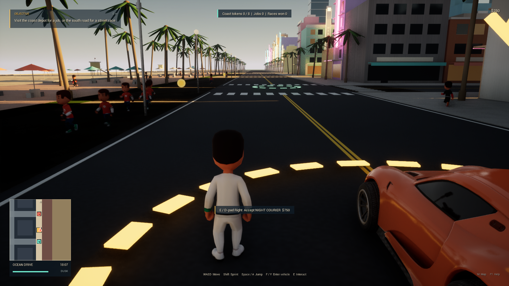
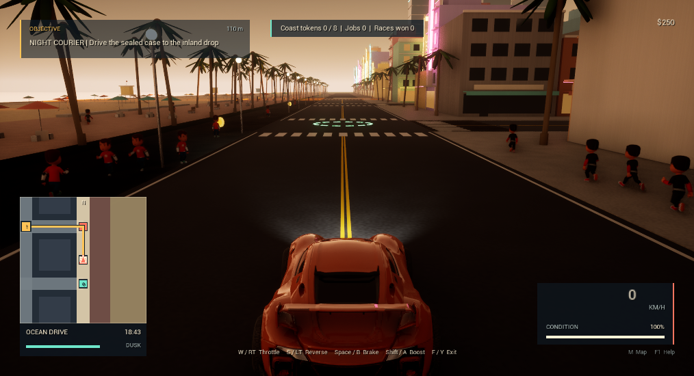
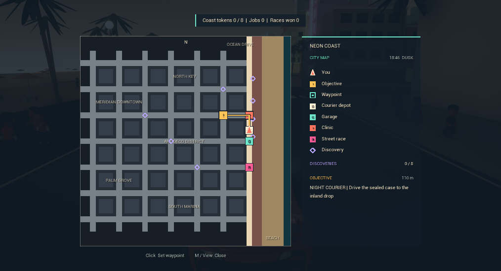
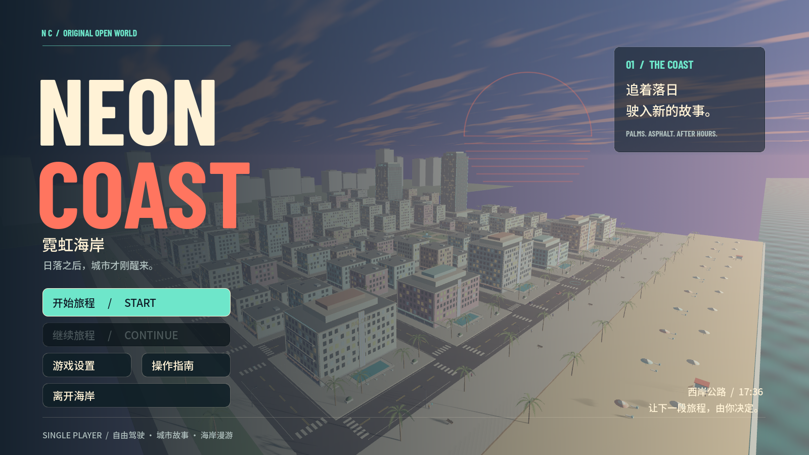
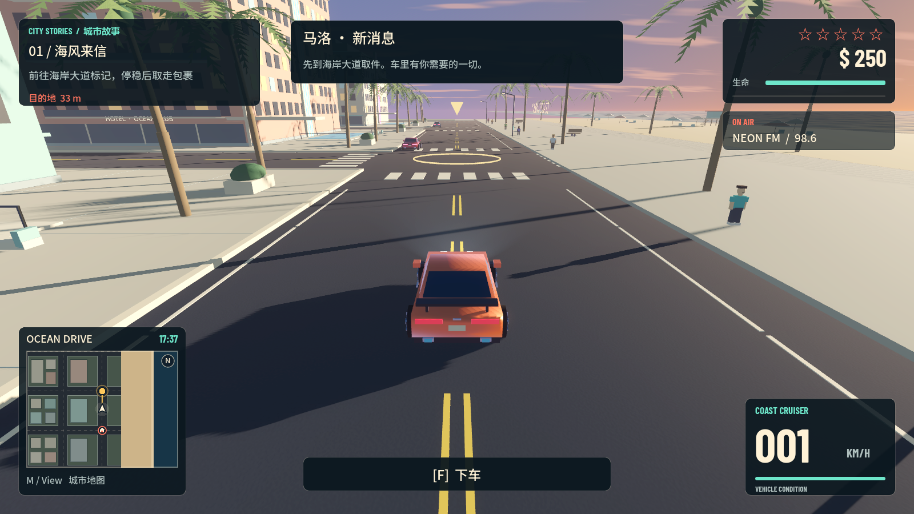

# NEON COAST · 霓虹海岸

## UE 5.8.4 游戏原型

当前新工程位于 `D:\NeonCoastUE\Unreal\NeonCoast.uproject`，Git 分支为 `ue5-migration`。
原 Godot 工程保留在 `D:\百度招新作业`；下方旧版截图、功能列表与 213 项测试记录只适用于 Godot 版。

Windows 独立版已可启动游玩，普通 DX12 游戏正常关闭、退出码 0，未出现引擎错误。最终独立包通过 **117 项真实世界检查：95 项玩法、22 项警方集成，0 项失败**；另有 2 项存档自动化测试通过。1600 × 900 独立 DX12 截图、720 帧渲染检查和正常退出均已验证。声音混音仍待听觉验收。

双击[启动游戏.cmd](启动游戏.cmd)，或直接运行[Windows 独立版](builds/NeonCoast-UE-Windows/Windows/NeonCoast.exe)。启动脚本优先使用已打包程序，无需打开 UE 编辑器。复制给其他电脑时需保留完整 `Windows` 文件夹；运行结果、发行文件哈希与验收范围见[验证记录](docs/UE_VERIFICATION.md)。

当前 UE 版包括 Chaos 四轮车辆物理、行驶中跳车、64 名行人、8 辆基础交通车、警车追捕、瞄准射击与换弹、三阶段原创快递任务、8 门街道赛、8 枚探索代币、现金/维修/医疗、进度存档、昼夜、地图与原创音频。城市、HUD 与材质视觉工作继续使用 **Claude Opus 5.5 high**；[第二轮回执](docs/UE_OPUS_SECOND_PASS_RECEIPT.json)记录其写入文件后触发会话额度限制，代码整合和运行验证由 Codex 完成。

这是原创的海滨开放世界原型。车辆使用 Epic 官方模板的骨骼与物理资产；角色采用 Kenney CC0 人类模型，包含三种服装和 Idle/Run/Jump 动画。**Opus 5.5 high** 实际查看素材预览与游戏截图，确定人物选择、178 cm 身高和材质参数，又完成世界标记、金币与黄昏可读性改进，见 [人物方案](docs/UE_CHARACTER_ART_DIRECTION.json)、[人物回执](docs/UE_CHARACTER_OPUS_RECEIPT.json)、[标记回执](docs/UE_MARKERS_OPUS_RECEIPT.json)与[光照回执](docs/UE_DUSK_OPUS_RECEIPT.json)。当前规模、动画、剧情和 AI 不等于 GTA VI。实际参考范围见 [官方资讯研究记录](docs/GTA_REFERENCE_NOTES.md)。

以下主图来自已打包的独立 DX12 游戏；驾驶与地图图来自同版编辑器交互验证：





默认入口 `启动游戏.cmd` / `打开工程.cmd` 已切换到 UE，`启动UE5.cmd` / `打开UE5工程.cmd` 仍可使用。也可以从工程目录执行：

```powershell
powershell -ExecutionPolicy Bypass -File tools/unreal.ps1 -Action Play
# 编译、资产生成、隔离存档的运行时检查
powershell -ExecutionPolicy Bypass -File tools/unreal.ps1 -Action Test
# 编辑器与本机原生 MCP
powershell -ExecutionPolicy Bypass -File tools/unreal.ps1 -Action Editor
```

首次开发构建需要先用 `python tools/generate-audio.py` 生成原创音频源文件；本机已生成。`Test` 包括玩法、警方集成和存档自动化测试。开发模式仍需要本机 UE；EXE 与 Pak/IoStore 内容文件哈希见 `artifacts/ue-release-verification.json`。

WASD 移动/驾驶，F 上下车或高速跳车，E 交互，鼠标右键瞄准、左键射击、R 换弹；M 地图，F1 帮助，Esc 暂停。完整键鼠/手柄操作、任务和存档说明见 [UE 工作流](docs/UE_MIGRATION.md)，实测证据与未验收项目见 [UE 验证记录](docs/UE_VERIFICATION.md)。

引擎与 Epic 车辆模板保留各自许可，不受项目 MIT 许可覆盖；Kenney 人物素材采用 CC0。见 [素材与许可说明](THIRD_PARTY_NOTICES.md)、[Epic 车辆来源](docs/licenses/EPIC_VEHICLES_PROVENANCE.md)、[人物来源](docs/licenses/KENNEY_CHARACTERS.md)和[原创音频来源](docs/AUDIO_PROVENANCE.md)。

## 旧 Godot 版本记录

**以下截图、功能、操作、测试和发布说明均为旧 Godot 版记录，不表示 UE 版拥有相同内容或已经通过相同验收。**

**海风、霓虹，以及一份不该接下的快递。**

本机工程根目录：`D:\百度招新作业`。游戏源码、Git 历史、测试和构建产物均在这个目录内。

用 Godot 4.7.2 制作的原创 3D 开放世界动作原型。故事围绕海滨城市中的四次行动展开：海风来信、潮汐账本、落日跑线和最后一程，包含取件送货、摆脱追捕和限时驾车。完成故事后可继续自由漫游。

本工程不是 Rockstar 的 GTA VI，不包含官方游戏代码、角色、音乐、标识或泄露素材。当前画面是程序生成的风格化场景，并非 AAA 写实制作。




## 直接游玩（旧 Godot 版）

- Windows 64 位：解压发布包，双击 `NeonCoast.exe`，无需安装 Godot。
- 当前仓库的旧版入口：双击 `启动旧版Godot.cmd`。优先运行旧版已导出程序，没有导出时使用本机 Godot。
- 编辑旧工程：用 Godot 4.7.2 打开 `project.godot`。默认 `打开工程.cmd` 现在打开 UE。
- 全程支持离线单人游玩。需要支持 OpenGL 3.3 的显卡。默认窗口可调整尺寸；设置中可切换全屏、画质、音量、视角灵敏度和 Y 轴反转。

初次进入后靠近橙色跑车，按 **F / 手柄 Y** 上车。键盘 **WASD** 驾驶，手柄 **RT / LT** 加速、刹车及倒车，左摇杆转向。**M / View** 打开地图，**Esc / Menu** 暂停。所有操作见 [操作说明](docs/CONTROLS.md)。

## 已实现内容（旧 Godot 版）

- 可驾驶城市道路、不同街区、海滨栈道和可步行沙滩；昼夜、海面、棕榈、建筑灯光与交通标线。
- 第三人称步行、奔跑、跳跃、瞄准、射击，上下车、车辆碰撞与损坏、手刹、加速、灯光、喇叭和道路救援。
- 12 辆循环行驶的民用车辆、停放车辆、32 名行人及受惊反应，按通缉等级生成的巡逻车和视线追踪。
- 四个顺序任务、一次限时路线挑战、10 张可收集明信片、现金奖励、车辆修理和医疗重生。
- 小地图、道路导航、自定义地图标记、任务提示、暂停和设置菜单，手柄/键鼠提示自动切换。
- 两套原创合成器电台、引擎声、海风、警笛及交互音效；照片模式和本地截图。
- 自动存档、读取、有效旧存档备份与损坏文件保护；手柄断开或窗口失焦时自动暂停。

这是可扩展的垂直切片：无联机、室内场景、完整城市交通规则、复杂人物剧情或 AAA 级角色资产。任务和追捕是轻量系统。手柄绑定通过合成事件验证；物理手柄的具体型号、蓝牙连接和振动手感仍需实机确认。

## 开发与验证（旧 Godot 版）

```powershell
# 安装经过官方 SHA-512 核验的引擎
powershell -ExecutionPolicy Bypass -File tools/setup-engine.ps1
# 如果也需要在新电脑导出 Windows，连同官方导出模板一起安装
powershell -ExecutionPolicy Bypass -File tools/setup-engine.ps1 -WithExportTemplates
# 自动化检查，不写入真实游戏进度
powershell -ExecutionPolicy Bypass -File tools/verify.ps1
# 导出 Windows：需要 Godot 4.7.2 的 Windows 导出模板
powershell -ExecutionPolicy Bypass -File tools/build.ps1
```

引擎默认位于 `D:\Work_software\Godot\4.7.2`；运行脚本也支持 `GODOT_EXE` 环境变量。Windows 导出包写入 `builds/`，源码、字体、测试和文档由 Git 管理；引擎、缓存、存档、构建产物、日志和凭据不进入仓库。

运行数据保存在 Godot 的 `user://` 目录（Windows 通常为 `%APPDATA%\Godot\app_userdata\Neon Coast · 霓虹海岸`）。照片位于其 `screenshots` 子目录。自动化测试使用隔离文件；`--test-mode` 禁止写入正式进度及设置。

六组自动化检查共 213 项通过，并完成 14 张原生渲染截图，覆盖 720p、900p 和 1440p；实际验证记录见 [VERIFICATION.md](docs/VERIFICATION.md)。Claude Code 已连接用户指定的 Claude Opus 5.5；地图界面由其 high 档生成。完整 HUD 请求多次超限或出现重复输出，最终主界面、游戏系统与整合由 Codex 及协作任务完成，具体边界见 [工具链记录](docs/TOOLCHAIN.md)。

## 同步 GitHub（旧 Godot 版记录）

已建立本地 `main` 分支。创建空 GitHub 仓库后，在工程目录执行：

```powershell
git remote add origin https://github.com/YOUR_ACCOUNT/NeonCoast.git
git push -u origin main
git push origin --tags
```

`builds/` 中的 Windows ZIP 适合上传到 GitHub Release，避免把引擎或可执行文件提交到源码历史。项目尚未自动创建远程仓库或公开发布。

## 许可与素材

项目原创代码与可自行授权的原创内容按仓库 `LICENSE` 提供；该授权不覆盖 Unreal Engine、Epic 模板车辆、从 Epic 示例改编的部分或其他第三方内容。Godot 为 MIT；Barlow Condensed 和 Noto Sans SC 字体采用 SIL OFL 1.1。UE 车辆使用 Epic 提供的网格、材质、骨骼、物理与动画资产，其余环境与原创音频的生成方式见 [第三方说明](THIRD_PARTY_NOTICES.md)。
