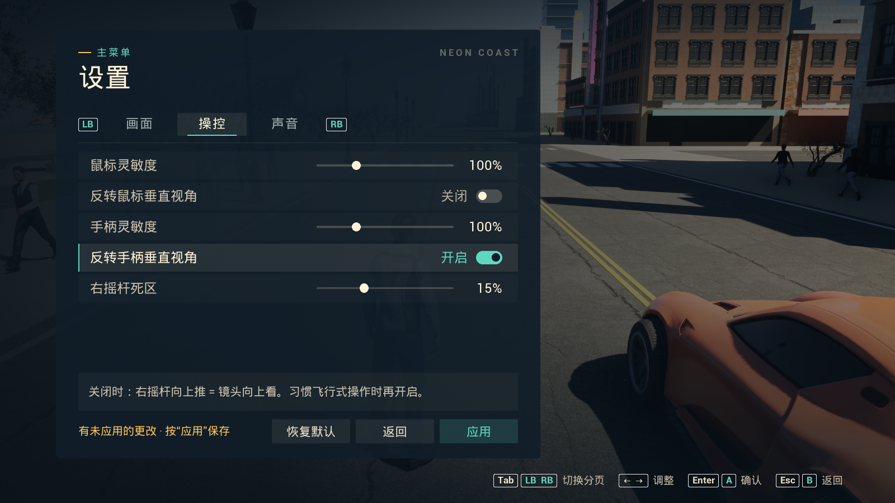

# v0.4.0 Windows 发行验证

2026-10-22，Unreal Engine 5.8.4。本文绑定实际安装版与便携版中的同一 Win64 Development 程序及加密 Cook 资源。旧版记录保存在 [v0.3 验证记录](UE_VERIFICATION_V0_3.md)。

[下载本版](https://github.com/j3488866194-bot/NeonCoast/releases/tag/v0.4.0) · [机器可读摘要](releases/v0.4.0-verification.json) · [菜单和设置说明](UE_FRONTEND.md)

## 验收结果

| 范围 | 结果 | 本机原始证据（不随 Git 分发） |
| --- | --- | --- |
| C++ / Cook / Stage / Archive | BuildCookRun 成功，ExitCode 0 | artifacts/v040-package-console.log |
| 原生菜单与输入 | **163 项通过、0 失败、退出码 0** | artifacts/ue-frontend-verification.json |
| 真实世界玩法 | **95 项通过** | artifacts/ue-release-smoke.log |
| 正常警方导演 | **22 项通过** | artifacts/ue-release-police.log |
| 设置与进度自动化 | **7 通过、0 失败** | artifacts/frontend-automation-accepted/index.json |
| DX12 实际渲染 | 720 帧、第 600 帧原生截图、ExitCode 0 | artifacts/ue-release-render-verification.json |
| 普通窗口关闭 | 主菜单就绪后等待 10 秒，向本次 UnrealWindow 发送 WM_CLOSE，ExitCode 0 | artifacts/ue-release-normal-exit-verification.json |
| 安装与卸载 | 15 项通过、1349 个安装文件逐一核对 SHA-256，安装/卸载 ExitCode 0 | artifacts/windows-installer-verification.json |
| 正式安装入口 | 从安装后的根目录 NeonCoast.exe 启动，隔离用户目录再次完成 163 项菜单/输入检查、ExitCode 0 | artifacts/installed-launcher-verification.json |
| 便携 ZIP | 解压流逐文件核对，排除本机存档、密钥和调试文件 | artifacts/windows-portable-verification.json |
| 资源保护 | 游戏 IoStore flags=11（数据与索引加密）、Pak 索引加密，无钥 UnrealPak 读取拒绝 | artifacts/ue-encryption-verification.json |

菜单检查覆盖启动/暂停/继续/返回主菜单/退出确认，真实 Slate 键盘与手柄导航，设置草稿、应用落盘、取消，显示模式手动恢复/15 秒超时/保留，以及实际窗口、无边框、全屏视口切换。异常退出显示恢复与旧配置迁移由设置自动化覆盖。切换全屏的 DX12 日志也记录了 Fullscreen=1。

右摇杆事件经过真实 FSceneViewport、PlayerInput 映射及步行/驾驶 Pawn。上推的实测俯仰变化：步行正常 25.00°、反转 -34.29°；驾驶正常 25.00°、反转 -34.04°。这证明当前软件输入路径的方向，不替代物理手柄硬件测试。

玩法覆盖 Chaos 加速/刹车/短平路车体抖动、高速跳车、人物跳跃、交通与行人、瞄准射击/遮挡、医疗、快递、比赛、代币和警方追踪/搜索。任务位置部分由夹具定位；不把夹具完成时间当成人工跑圈成绩。正常场景确认 65 名扫描人物、9/9 公共模型、16/16 PBR 材质加载，无资产回退。

安装器实际验证桌面/开始菜单、当前用户卸载注册、全量文件校验、卸载移除程序/快捷方式，并保留专门创建的 Saved 哨兵存档。当前机器已有 VC 运行库；未将此当成缺依赖新电脑的验收。官方 Inno Setup 编译器已核对官方 SHA-256 及有效 Authenticode，游戏安装 EXE 本身未购买代码签名。

## 实际画面

以下截图来自本版独立程序，已目视检查标题、中文控件、人物姿态与道路/车辆，1600×900。较早同功能菜单也在 1280×720 完成检查。首屏会先让角色姿态和车辆悬挂初始化，再暂停场景；暂停时保留相机渲染历史，避免冻结的运动模糊。

设置图是验收中手动打开“反转手柄”的未应用草稿，默认反转关闭。

## 性能范围

RTX 5060 Laptop，DX12，1600×900，High，60 FPS 上限，静止出生点。预热后零基帧 240–598 共 359 帧，排除截图开销。平均 **60.0 FPS**；FrameTime 均值 16.670 ms、P95 17.551 ms；GPU 均值 7.434 ms。这不是全城驾驶、无上限性能、任意电脑或长时间稳定性的保证。

## 文件绑定

程序 SHA-256：`0303a58132e62db819e47ba6b734575c10ac21bbce89af0cdec86751356e1ddb`。

| 内容文件 | 字节 | SHA-256 |
| --- | ---: | --- |
| global.ucas | 3,344,192 | `928e3a35e90a2c99db8bc23d055c36747d09a0c9649f3705c664a29494ccb239` |
| global.utoc | 818 | `bb612221ce66d3c068920c1755c3f649028614615133340d7527980f43e905cd` |
| NeonCoast-Windows.pak | 11,269,862 | `6f0b189e42bb5faaad05d12613844ea8062697ed0295d0283d876cb9607cc457` |
| NeonCoast-Windows.ucas | 569,312,288 | `6009945e324ad8fce06d566b16cbf452582d959b9c0b3d7b81fae11beb8d8bb8` |
| NeonCoast-Windows.utoc | 337,290 | `bfe1d48c82af0f6e121b3ef710152214aa5c58c3e29f560728e982b57c0f5a37` |

| 发行文件 | 字节 | SHA-256 |
| --- | ---: | --- |
| NeonCoast-0.4.0-Windows-Portable.zip | 771,359,940 | `139223176237facd96e8f7d6f74c60239f2c5148147c51e7a96ee90356486633` |
| NeonCoast-0.4.0-Windows-Setup.exe | 744,453,272 | `f83d27a2179d211bcb15ea7e414939ba953ce91a20fa2d9e36e84e390a2f9711` |

菜单、玩法、渲染、窗口退出和安装程序中的 EXE 与全部容器逐项同哈希；分发 ZIP 另逐文件读取核对。源码与配置聚合哈希见机器摘要，排除本机 DefaultCrypto.ini。安装包 manifest 的 source_commit 是构建前基线，source_worktree_dirty=true；本版以实际源码聚合、EXE 与容器哈希绑定，不冒称旧基线就是最终源码。

首次本版玩法脚本取得了全部 95 PASS，但 Windows PowerShell 返回空 ExitCode，报告按失败处理。已移除 GUI 标准流重定向并保留进程句柄，重跑同一未变化 EXE 后通过 95+22 项及真实 ExitCode 检查。没有将缺失退出状态当作成功。

## 视觉、许可与限制

主菜单与设置使用实际 Claude Opus 5.5 high 的两轮生成/修订；[回执](UE_FRONTEND_OPUS_RECEIPTS.json)保留会话和作者文件哈希。Codex 完成控制器接入、输入/音量/配置、显示恢复、启动初始化、编译修正和测试。游戏写实资产的六轮历史视觉参与另见[写实说明](UE_REALISM.md)。

原创代码 MIT，公共环境 CC0，Epic Examples 和 Renderpeople 人物各保留原许可。[发行许可](RELEASE_LICENSE.txt)、[第三方声明](../THIRD_PARTY_NOTICES.md)。加密保护已按容器和无钥读取实际验证，不能据此声称不可逆向或供应商另行批准。源码不含原始扫描人物、未 Cook 人物资产、UE 引擎或加密密钥；重建须自行取得合法素材。

当前仍是开放世界原型，缺少完整室内、联机、船舶/飞机、完整剧情和 AAA 级角色交互动画，两种人物外观重复。物理手柄型号、混音试听、多设备、磁盘故障恢复和长时间游玩仍需要单独验收。
