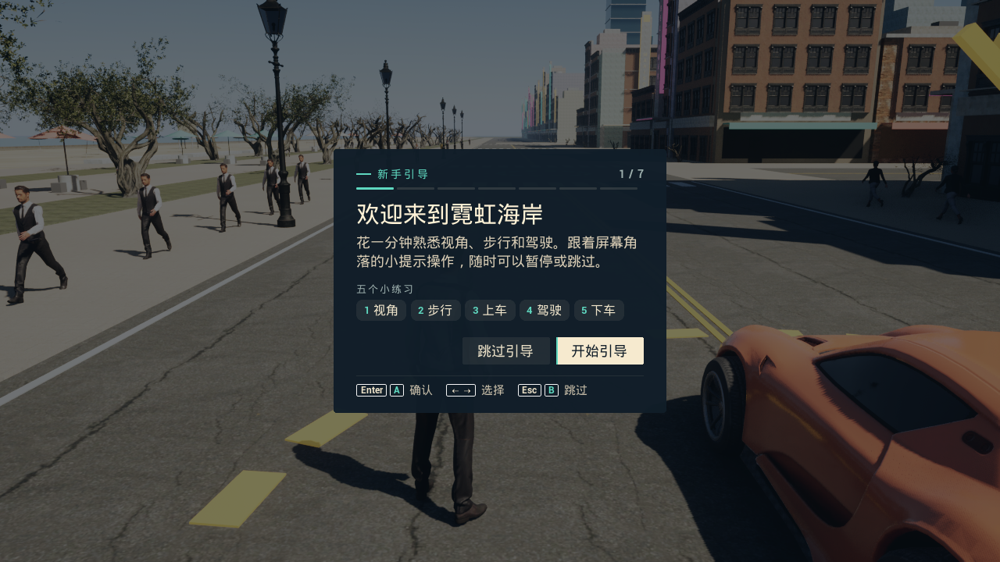
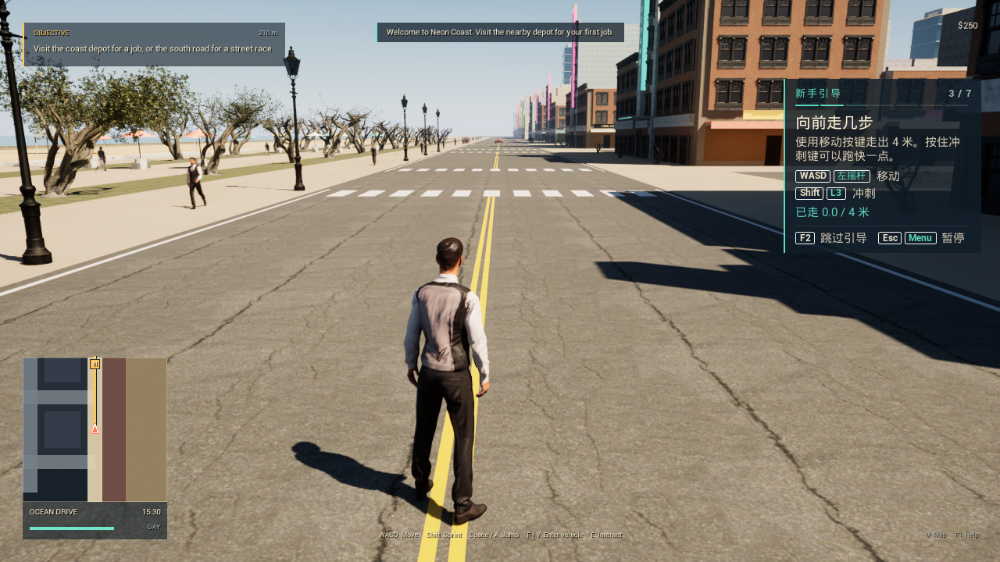
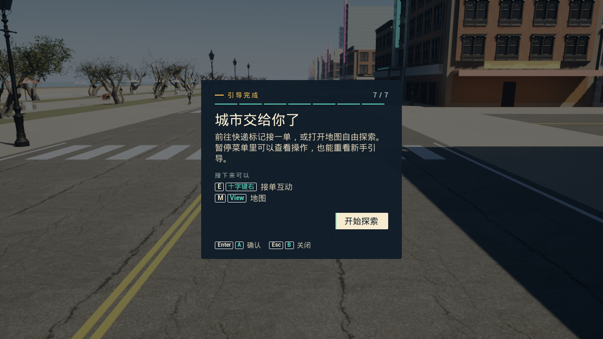

# v0.4.1 Windows 发行验证

2026-10-22，Unreal Engine 5.8.4。本记录绑定本次安装包、便携包及测试使用的同一 Win64 Development 程序与加密 Cook 资源。[v0.4.0 历史验证](UE_VERIFICATION_V0_4_0.md)单独保留，其性能及安装卸载数字不算本版结果。

[本版下载](https://github.com/j3488866194-bot/NeonCoast/releases/tag/v0.4.1) · [机器可读摘要](releases/v0.4.1-verification.json) · [功能说明](UE_FRONTEND.md)

## 本版验收

| 范围 | 已取得结果 | 本机证据（不随 Git 分发） |
| --- | --- | --- |
| C++ / Cook / Stage / Archive | BuildCookRun 成功，ExitCode 0 | artifacts/v041-package-console.log |
| 游戏主混音 | **50 项通过**，11 段实际 PCM 录制 | artifacts/ue-audio-verification.json |
| 原生菜单与输入 | **183 项通过**，退出码 0 | artifacts/ue-frontend-verification.json |
| 首次与返回玩家引导 | **84 + 16 = 100 项通过**，两个独立进程均退出码 0 | artifacts/ue-onboarding-verification.json |
| 启动显示模式 | **95 项通过**，5 个实际游戏进程 | artifacts/ue-startup-display-verification.json |
| 玩法与警方 | **95 + 22 = 117 项通过** | artifacts/ue-release-verification.json |
| 设置与进度自动化 | 编辑器自动化 **9/9 通过**，0 警告、0 失败、0 未运行 | artifacts/v041-automation/index.json |
| DX12 渲染与正常关闭 | 720 帧采样、第 600 帧截图；主菜单就绪后 WM_CLOSE，均退出码 0 | artifacts/ue-release-render-verification.json；artifacts/ue-release-normal-exit-verification.json |
| v0.4.0 原位升级 | **20 项通过**，1349 个载荷文件核验；2 个既有用户文件、2 个目录保留，0 违规，安装退出码 0 | artifacts/windows-upgrade-verification.json |
| 便携 ZIP | **1349 个文件逐一校验通过** | artifacts/windows-portable-verification.json |
| 最新进度迁移 | 备份后将两份存档及设置复制到安装版/便携版，**6 次文件复制逐一哈希相符** | artifacts/v041-user-progress-migration.json |
| 安装版实际入口 | 首次运行遇到 GPU 超时；相同方式重试 **18 项通过**，桌面尺寸 2560×1440 无边框，退出码 0 | artifacts/installed-launcher-verification.json |
| 安装版短时观察 | 原生桌面无边框，主菜单就绪后运行 **120 秒**，WM_CLOSE 正常退出，退出码 0 | artifacts/v041-installed-stability-verification.json |
| 资源加密 | 游戏 IoStore flags=11、Pak 索引加密；无钥 UnrealPak 读取被拒绝 | artifacts/ue-encryption-verification.json |

上述检查均完成；各类检查保留自己的范围，不把编辑器自动化、软件注入事件或文件校验当作完整人工游玩。

**已知 GPU 稳定性问题：** 安装版首次入口检查在本机 RTX 5060 Laptop / 驱动 616.92 上发生一次 `DXGI_ERROR_DEVICE_HUNG`，进程退出码 3。Aftermath 报告 Timeout，活动着色器位于虚拟阴影的非 Nanite 绘制命令剔除；当时显存使用约 3.20 GB，低于约 7.13 GB 预算，不能据此归因于显存不足。相同启动方式未作代码或设置改动的重试通过，随后 120 秒正常标题界面观察也通过。引擎/驱动根因仍未确认；通过的重试不抹去首次失败，也不等于长时间稳定性已验收。原始崩溃日志含本机标识，仅本地保留，公开摘要只记录诊断事实。

菜单音乐、菜单海风、步行环境声、车辆引擎和电台均从游戏主混音录得非零 PCM；总音量和分类静音用例的 RMS/峰值均为 0。声音设置试听也实际产生混音输出。录制位于 **Windows 终端路由之前**，因此不证明扬声器、耳机或显示器的物理可听性，也不替代主观混音试听。

启动显示覆盖新配置、旧版迁移、关闭自动无边框、未确认显示设置恢复和命令行覆盖。新旧配置的本机无边框视口均为桌面尺寸 3840×2160；关闭选项和恢复用例保持窗口模式。菜单仍通过窗口/无边框/全屏切换、保留/撤销及 15 秒超时恢复检查。

引导检查通过真实 Slate 控件与视口输入完成视角、步行、上车、驾驶停稳、下车、跳过和重看；另启进程确认完成状态持久化。夹具实际步行约 4.05 米、驾驶约 20.22 米。右摇杆仍经过 FSceneViewport → PlayerInput → 步行/驾驶 Pawn，正常上推与反转的符号符合设置；**实体手柄型号和连接情况尚未单独验收**。

正常渲染场景加载 65 名扫描人物（主角及 64 名行人）、9 套公共模型和 16 套 PBR 材质。玩法检查含 Chaos 驾驶/刹车、短平路车体抖动、高速跳车、射击遮挡、医疗、快递、比赛、代币和警方追踪。任务部分使用位置夹具，记录的完成时间不是人工跑圈成绩。

## 本版实际画面

以下欢迎、步行和完成画面来自最终独立程序，均为 **1280×720**；已目视检查中文控件、键位提示和画面层级。欢迎/完成面板下不再叠加旧暂停界面。

[本版主菜单](images/ue/main-menu.png)、[本版设置](images/ue/settings.png)及[1600×900 游戏画面](images/ue/packaged-game.png)也与对应报告逐一核对 SHA-256。设置截图是验收过程中的草稿状态，不代表默认反转设置。截图的生成与目视检查分开记录。

本版已完成 DX12 原生渲染采样，**本记录不发布本版 FPS 统计，也不沿用 v0.4.0 的帧率数字**。

## 文件绑定

最终游戏 EXE SHA-256：`f0d885204bb0917d8cdc6b625ddc00e6ab33f42973a76582a4e2e7571930f947`。

| 内容文件 | 字节 | SHA-256 |
| --- | ---: | --- |
| global.ucas | 3,344,880 | `26e58fa571512490c83ea4744d3465c8fd9caffc573fe31fc62acc9f11156643` |
| global.utoc | 818 | `dfdf51442734fb2a33a4dbfb69dfb4180f05f77b19da4a671b9515cb80892131` |
| NeonCoast-Windows.pak | 11,269,862 | `451acb7753f19e0e18ff95f394e389fd959943578293359042e6c0f53e5564b8` |
| NeonCoast-Windows.ucas | 569,312,288 | `51cfbe03ea786bd809ace054b3a8772689a21b7e1dfcd04fbdfbfe4aa4b247af` |
| NeonCoast-Windows.utoc | 337,290 | `502677230fe72694762128f8bbeebe6d5c5bf079a205e052430062db9fd0660a` |

| 发行文件 | 字节 | SHA-256 |
| --- | ---: | --- |
| NeonCoast-0.4.1-Windows-Portable.zip | 771,434,830 | `32208b982d5fbb7a37f3adc8dad5ff2b2892c05103485344d36665420d5e329a` |
| NeonCoast-0.4.1-Windows-Setup.exe | 744,510,404 | `2e1fba4a0ab6f6f7e267fbb17d1d7b1450e585bce0822537a37486f575f90914` |

声音、菜单、引导、显示、玩法、渲染、退出报告与安装/便携载荷的 EXE 和容器均逐项同哈希。当前公开源码/配置共 58 文件，聚合 SHA-256 为 `5f96d6821765beda8be28ca93ace1b9d28550943642769fe77e9b7ae50612aa6`，已与安装 manifest 相符；排除本地加密配置。编辑器自动化再次生成的 AndroidFileServer 配置已清除。manifest 的 source_commit 是构建前 v0.4.0 基线，source_worktree_dirty=true，不能把该旧提交当成最终源码；具体聚合算法见机器摘要。

升级验收没有卸载原游戏；现有两份用户文件逐字节保留。随后单独备份并迁入最新进度。当前机器已有 VC 运行库，不把本次升级当作缺依赖新电脑的安装测试。游戏安装 EXE 仍未进行商业代码签名。

## 视觉、许可与验证边界

新增中文引导和设置视觉由实际 Claude Opus 5.5 high 完成，[作者回执](UE_ONBOARDING_OPUS_RECEIPTS.json)记录会话及文件哈希；Codex 完成接入、音频/显示/引导逻辑、技术修正与验证。历史菜单和写实视觉贡献保留在各自回执中。

公开候选文件已检查常见令牌、私钥、AFS 与 AES 配置模式和排除路径，未检出命中；原始扫描人物、未 Cook 人物资源、构建目录和密钥保持忽略。模式扫描不等于能排除所有形式的秘密。原创代码 MIT、环境 CC0，Epic Examples 与 Renderpeople 人物保留自己的许可，见[发行许可](RELEASE_LICENSE.txt)和[第三方说明](../THIRD_PARTY_NOTICES.md)。加密验证不表示不可逆向或供应商另行批准。

这是单机开放世界原型；完整室内、联机、船舶/飞机、完整剧情和 AAA 级角色交互动画尚未实现。多设备、物理听感、实体手柄、长时间游玩和全城驾驶性能仍需另行验收。
