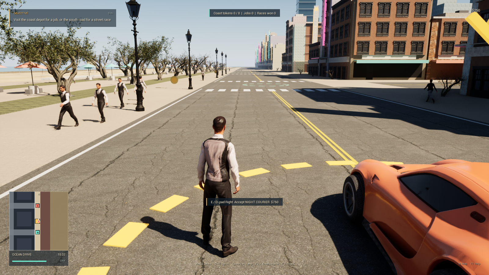

# UE 写实版验证记录

日期：2026-10-22（Asia/Shanghai），UE 5.8.4，项目版本 0.3.0-dev。以下结果来自本轮新打包的独立 Windows 游戏；旧 Godot 和旧 Kenney 人物包的成绩不计入本轮。

## 当前结果与启动

**新版独立包通过 117 项真实世界检查：95 项玩法、22 项警方，0 项失败。** 同包独立 DX12 渲染完成 720 帧并于第 600 帧截图，退出码 0，引擎错误数 0。正常场景确认主角加 64 名行人均使用 Eric/Carla 扫描模型，9/9 个公共模型、16/16 个 PBR 材质加载，无人物或材质编译回退。

双击[启动游戏.cmd](../启动游戏.cmd)，或[Windows 游戏入口](../builds/NeonCoast-UE-Windows/Windows/NeonCoast.exe)。无需打开编辑器。复制游戏时须完整保留 `Windows` 文件夹。

| 项目 | 本轮结果 | 本地证据 |
| --- | --- | --- |
| C++、Cook、Stage、Archive | BuildCookRun 成功、退出码 0；Cook 0 errors / 0 warnings | `artifacts/ue-package.log` |
| 独立包玩法 | 95 PASS，0 FAIL | `artifacts/ue-release-smoke.log` |
| 独立包正常警方导演 | 22 PASS，0 FAIL | `artifacts/ue-release-police.log` |
| DX12 渲染和基准退出 | 720 帧，ExitCode 0，engine_failures 0 | `artifacts/ue-release-render-verification.json` |
| 普通独立游戏关闭 | 不启用 CSV；音频就绪后运行 10 秒，再向本次游戏窗口发送 WM_CLOSE；ExitCode 0，engine_failures 0 | `artifacts/ue-release-normal-exit-verification.json` |
| 写实资产运行 | 65 扫描人物、9 种公共模型、16 种 PBR 材质 | `artifacts/ue-release-render-verification.json`、`artifacts/ue-release-render.log` |
| 公共模型导入 | 15 网格、原始材质槽/UV保留；9 种实际用于城市 | `Unreal/Saved/PublicModelImportReport.json` |
| HISM 公共材质 | 15 网格、31 槽，材质实例化使用标志校验完成 | `Unreal/Saved/PublicMaterialUsageReport.json` |
| 扫描人物资产 | Eric/Carla，各95骨骼；原始图集、2K预算、3级LOD | `Unreal/Saved/RealisticCharacterFinalizeReport.json` |
| 动画重定向 | 每人 Idle/Walk/Run/Jump；8段各21次采样，原地root位移范围0 cm | `Unreal/Saved/RealisticCharacterImportReport.json` |
| 音频初始化 | 两个电台、四个循环声就绪；未作混音听觉验收 | `NC_AUDIO_READY radioTracks=2 loops=4` |
| 来源文件 | Poly Haven 54文件165,503,508字节；人物2 ZIP及26解压文件本地哈希/CRC一致 | 下载清单、`tools/fetch-scan-characters.py --offline` |

## 当前实机画面与性能

以下为新独立 Windows DX12 程序实际渲染，1600×900。运行 ID `404a80bdee59476f892796e8132861b4`，完成时间 `2026-10-22T10:59:15.9052110+08:00`。已目视检查成人比例、脚底接触、NPC、建筑窗体、树木、路灯、道路材质与车辆。此前卡通版保存在[改造前截图](images/ue/before-realism.png)；`driving.png`、`map.png` 属于此前 v0.2 编辑器验证，不能当作本轮截图。

性能条件：本机 RTX 5060 Laptop、DX12、1600×900、High、60 FPS 上限，静止出生点；取预热后零基帧240–598，共359帧，排除第600帧截图开销。

| 指标 | 平均 | P95 |
| --- | ---: | ---: |
| FrameTime | 16.668 ms | 17.430 ms |
| GameThreadTime | 5.116 ms | 5.955 ms |
| RenderThreadTime | 6.097 ms | 6.961 ms |
| GPUTime | 7.362 ms | 7.856 ms |

按平均帧时间计算为 **60.0 FPS**。这只代表该短时静止场景，不保证全城驾驶、无上限帧率、所有分辨率或长时间稳定性。`tools/measure-ue-render.py`核验同一CSV、EXE、Pak哈希后提取数据，不测量曝光或sRGB色值。

## 行为覆盖及边界

- Chaos 四轮刚体、接地、加速与刹停；短平路车体竖直抖动、高速跳车的继承速度/伤害/恢复、落地与步行跳跃。
- 至少9辆基础车、64名行人的存在与真实Tick移动；瞄准、射击、弹匣/备弹、NPC受击/惊恐、枪口遮挡和犯罪热度。
- 医疗扣款、死亡恢复与任务清理；三阶段快递任务、拒绝步行或远程交付、真实时间搜索与$750结算。
- 8门比赛顺序、拒绝跳门/步行、$450结算及最佳时间；8枚代币、奖励和重复领取防护。
- 警方正常导演派车、真实物理移动、目击位置更新、失去视线后搜索、废车替补和随时间消退。
- 玩法检查禁用玩家存档。进度经过内存序列化；此前另有2项SaveGame自动化测试通过，本轮未重新将它们计为新测。

检查采用真实世界Tick，但部分任务/比赛/代币位置由夹具定位；比赛约4秒的夹具成绩不代表玩家驾车跑完整圈。短平路车体测量不保证任意路线摄像机没有抖动。存档未覆盖磁盘损坏、备用档跨进程恢复；物理手柄、混音试听、多设备和长时间游戏仍未完整验收。

本轮原始行为测量可在 `artifacts/ue-release-verification.json` 的 `metrics` 与 `police_metrics` 中查看；这些读数与下面的实际程序和全部内容文件绑定。

本轮较早的包出现一次射击检查偶发失败，日志保留在 `artifacts/realism/first-final-smoke-failed.log`；同一旧包复跑通过，根因未证实。随后仅对相机已命中目标时的枪口射线终点增加 2 cm 容错，保留最近遮挡检测，并将瞄准夹具统一为实际开火使用的玩家视角、增加瞄准误差日志。最终结果以本文绑定同一发行包的检查为准，未将复跑成功当作根因已证明。

## 视觉贡献、资源与限制

实际使用 **Claude Opus 5.5 high** 完成写实方案、PBR/人物材质、城市模型布置与光照、首次预览复查、恢复后的视觉复查和目标标记收尾，共[六轮实际调用](UE_REALISM_OPUS_RECEIPTS.json)。回执保留模型、会话和作者输出哈希；标记收尾将路径标记调整为更薄的琥珀色。[首次视觉复查](UE_REALISM_VISUAL_REVIEW.json)与[恢复后的复查](UE_REALISM_RESUME_REVIEW.json)分别基于其列出的静态预览，不代表最终独立包验收。复查中的色值是目测估计，技术假设与建议不作为已修复的证据。Codex完成导入、动画重定向、引擎API修正、位置/碰撞约束、构建和最终检查。

公共建筑、海岸阔叶树、长椅、路灯与表面贴图来自Poly Haven CC0。Eric/Carla来自Renderpeople的专有免费许可，原始和未Cook人物资产不进入Git；动画来自合法安装的Epic模板。来源、许可、哈希和本机重建流程见[写实升级说明](UE_REALISM.md)、[公共资源许可](licenses/PUBLIC_ASSETS.md)、[扫描人物许可](licenses/RENDERPEOPLE.md)及[统一第三方声明](../THIRD_PARTY_NOTICES.md)。

当前仍是原创开放世界原型：两种扫描人物服装重复，缺少独立瞄准/换弹/死亡及完整交互动画；部分建筑主体和海滩道具仍为程序几何，树/灯使用既有简单碰撞代理。没有完整室内、联机、船舶/飞机、完整剧情或GTA VI级城市与动画。源素材更写实不等于这些系统已经实现。

## 发行文件绑定

玩法运行 `6af937e9643048f5a1c8a0ad8fd36d69`，完成 `2026-10-22T11:00:54.6304239+08:00`；与上面的渲染报告逐项比较，实际EXE及全部Pak/IoStore文件SHA-256一致。

实际程序：`D:\NeonCoastUE\builds\NeonCoast-UE-Windows\Windows\NeonCoast\Binaries\Win64\NeonCoast.exe`，332,905,472字节，SHA-256 `e4bf2dd86ef770d63916c833a64fecd056cc4a9675d84ecedd5e266c17c9cd41`。

| 内容文件 | 字节 | SHA-256 |
| --- | ---: | --- |
| global.ucas | 3,343,920 | `c66bffab1b10de137309aaa089b0704d7cb244e29b5b0746bc2b0cad5837eab5` |
| global.utoc | 818 | `c5dd1432c044e301975cb7d75d70924eb5ec6828ea0a731484fde0b7d9557dd9` |
| NeonCoast-Windows.pak | 11,258,107 | `e401bfbacd957e2625036fba736b963801ae41cd56c91c2179e05da359c19a4c` |
| NeonCoast-Windows.ucas | 569,312,288 | `d3c86cb35b2134ae552e74881729b715399ccebf58ab6027d05da8a3e6a7e24e` |
| NeonCoast-Windows.utoc | 337,287 | `8ce12c16d42e1d88483465f79dadd5e19f14abbfaaa991fe1404a48b36a84b74` |

截图SHA-256 `c02c44197f50755d8c1b8511e5ae8bad28153b107d8ef5e26ae3eccd41c965b4`；CSV SHA-256 `ddec8d09c0c23eaebadeef5daa3f7406f5dd3efb53633e190bb40d78db187082`。完整本地报告位于忽略提交的 `artifacts/`，游戏包位于 `builds/`；克隆源码不会自动取得这些本机文件。

渲染检查采用 `-csvNoProcessingThread` 绕过本机UE异步CSV退出异常；这是基准开关，正常玩家启动不启用CSV。同包另运行了普通 DX12 游戏关闭检查：隔离 UserDir，不启用 CSV；音频就绪后运行 10 秒，再仅向本次进程的 UnrealWindow 发送 WM_CLOSE，实际退出码 0、引擎错误数 0。该检查运行 ID `b0cad41aad9e46f3822ecbb04e438ffd`，完成于 `2026-10-22T11:01:12.0325742+08:00`，日志 `D:\NeonCoastUE\artifacts\ue-release-normal-exit-b0cad41aad9e46f3822ecbb04e438ffd.log`；其 EXE 与全部 Pak/IoStore 哈希也与玩法及渲染记录一致。两种退出证据分别保存，没有把仅生成 PNG 当作正常窗口关闭证明。
